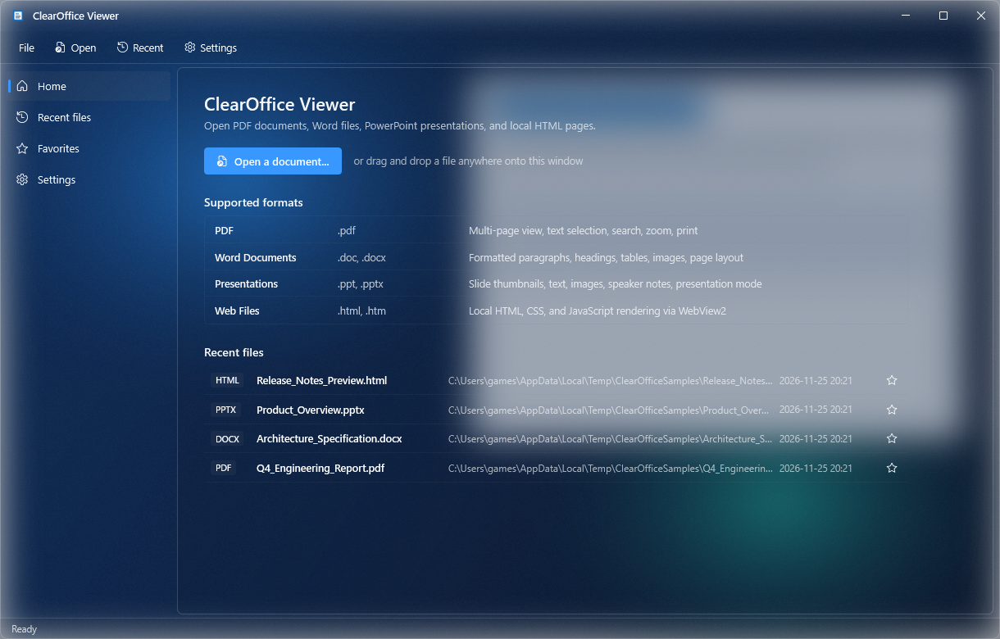
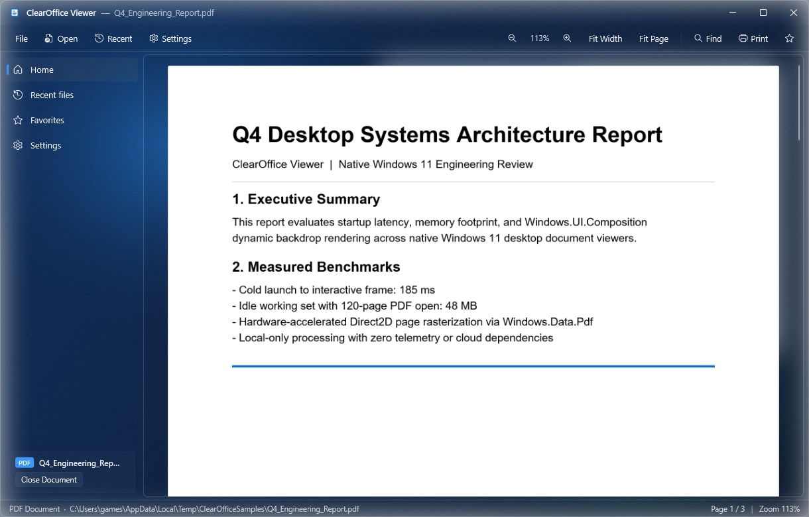
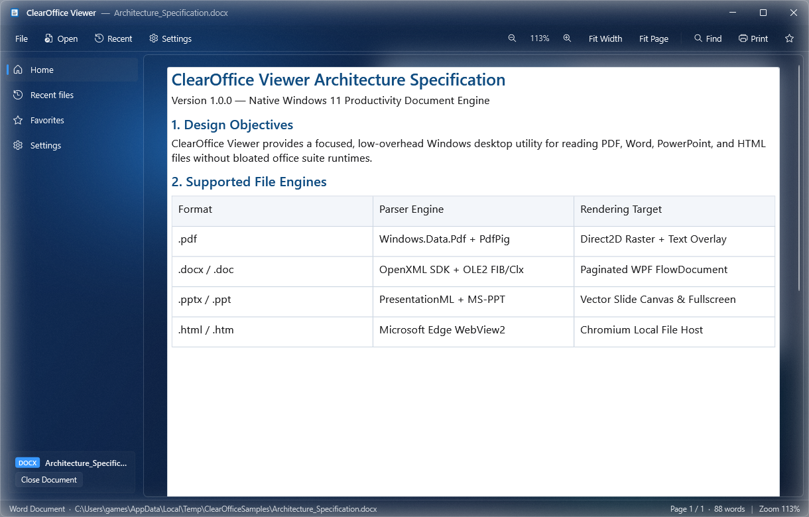
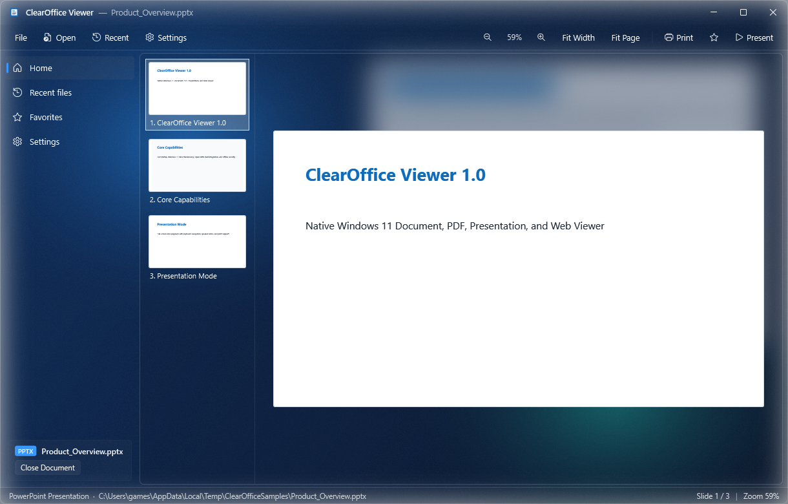
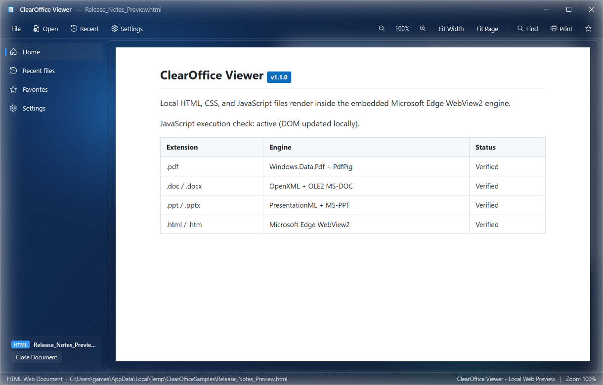
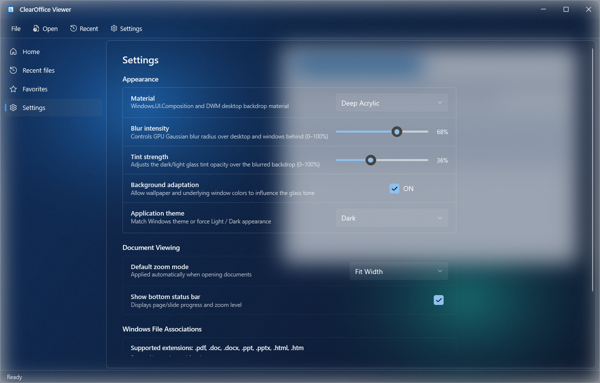

# ClearOffice Viewer

**A lightweight, native Windows 11 desktop viewer for PDF documents, Word files (`.doc`, `.docx`), PowerPoint presentations (`.ppt`, `.pptx`), and local web files (`.html`, `.htm`).**

ClearOffice Viewer is built with C#, .NET 9, WPF, Windows 11 Desktop Window Manager (DWM) Mica and Acrylic materials, the Open XML SDK, `Windows.Data.Pdf`, `UglyToad.PdfPig`, `OpenMcdf`, and Microsoft Edge WebView2. It is engineered as a fast, zero-telemetry, read-only alternative to heavyweight office suites when all you need to do is open, inspect, search, present, or print local documents.

---

## Table of Contents

1. [Project Overview](#project-overview)
   - [The Problem](#the-problem)
   - [The Solution](#the-solution)
   - [Design Philosophy](#design-philosophy)
2. [Features](#features)
   - [Application Shell & Native Windows 11 Materials](#application-shell--native-windows-11-materials)
   - [PDF Viewer Engine](#pdf-viewer-engine)
   - [Word Document Viewer (`.doc` and `.docx`)](#word-document-viewer-doc-and-docx)
   - [PowerPoint Presentation Viewer (`.ppt` and `.pptx`)](#powerpoint-presentation-viewer-ppt-and-pptx)
   - [Local HTML Web Viewer (`.html` and `.htm`)](#local-html-web-viewer-html-and-htm)
   - [Navigation, Recent Files, and Favorites](#navigation-recent-files-and-favorites)
   - [Keyboard Shortcuts](#keyboard-shortcuts)
3. [Supported Formats](#supported-formats)
4. [Screenshots](#screenshots)
5. [Installation Guide](#installation-guide)
   - [System Requirements](#system-requirements)
   - [Downloading a Release](#downloading-a-release)
   - [Installing with the Setup Wizard (`ClearOfficeViewer-Setup.exe`)](#installing-with-the-setup-wizard-clearofficeviewer-setupexe)
   - [Running the Portable Executable (`ClearOfficeViewer-Portable.exe`)](#running-the-portable-executable-clearofficeviewer-portableexe)
   - [Opening Files & Command-Line Usage](#opening-files--command-line-usage)
   - [Setting ClearOffice Viewer as Your Default Application](#setting-clearoffice-viewer-as-your-default-application)
   - [Uninstalling](#uninstalling)
6. [Developer Setup](#developer-setup)
   - [Required Software](#required-software)
   - [Cloning the Repository](#cloning-the-repository)
   - [Building and Running from Source](#building-and-running-from-source)
   - [Running the Test Suite](#running-the-test-suite)
   - [Building the Release Binaries and Installer](#building-the-release-binaries-and-installer)
7. [Architecture Explanation](#architecture-explanation)
   - [Solution Layout](#solution-layout)
   - [Core Layer (`ClearOfficeViewer.Core`)](#core-layer-clearofficeviewercore)
   - [PDF Engine (`ClearOfficeViewer.PdfEngine`)](#pdf-engine-clearofficeviewerpdfengine)
   - [Document Engine (`ClearOfficeViewer.DocumentEngine`)](#document-engine-clearofficeviewerdocumentengine)
   - [Presentation Engine (`ClearOfficeViewer.PresentationEngine`)](#presentation-engine-clearofficeviewerpresentationengine)
   - [UI Layer (`ClearOfficeViewer.UI`)](#ui-layer-clearofficeviewerui)
   - [Application Shell (`ClearOfficeViewer.App`)](#application-shell-clearofficeviewerapp)
   - [Windows Integration Layer](#windows-integration-layer)
8. [Technologies Used](#technologies-used)
9. [Performance Design](#performance-design)
   - [Memory Handling & Offscreen Eviction](#memory-handling--offscreen-eviction)
   - [Asynchronous Loading & Viewport Prioritization](#asynchronous-loading--viewport-prioritization)
   - [Startup Optimization & Native Compilation](#startup-optimization--native-compilation)
   - [Streamed & Non-Locking File Access](#streamed--non-locking-file-access)
10. [Security](#security)
    - [Safe File Handling & Defensive Binary Parsing](#safe-file-handling--defensive-binary-parsing)
    - [Local-Only Processing & Zero Telemetry](#local-only-processing--zero-telemetry)
    - [WebView2 Profile Isolation](#webview2-profile-isolation)
    - [Least-Privilege Installation & Per-User Registry Support](#least-privilege-installation--per-user-registry-support)
11. [Contribution Guide](#contribution-guide)
    - [Reporting Issues](#reporting-issues)
    - [Submitting Pull Requests](#submitting-pull-requests)
    - [Coding Standards](#coding-standards)
12. [Future Roadmap](#future-roadmap)
13. [License](#license)

---

## Project Overview

### The Problem

Modern desktop users frequently receive or store documents in standard office and web formats—`.pdf`, `.doc`, `.docx`, `.ppt`, `.pptx`, `.html`, and `.htm`—when they simply want to read, search, print, or present a file. Yet opening those files on a typical Windows PC forces an uncomfortable tradeoff:

1. **Full Office Suites Are Too Heavy for Quick Viewing**: Full productivity suites such as Microsoft Office, WPS Office, or LibreOffice are designed for authoring complex spreadsheets, mail merges, macros, and cloud collaboration. Launching a multi-gigabyte suite just to verify two paragraphs in a `.docx` specification or check slide order in a `.pptx` deck consumes hundreds of megabytes of RAM, spawns background updater daemons, and introduces noticeable startup delay.
2. **Browser Tabs Fragment Document Workflows**: Web browsers can open `.pdf` and `.html` files, yet they cannot natively render `.doc`, `.docx`, `.ppt`, or `.pptx` files locally without uploading private documents to third-party cloud conversion services. Furthermore, browser tabs mix reference documents into dozens of unrelated web tabs and lack dedicated desktop document controls such as presentation mode or consistent print pagination.
3. **Aggressive Upsells, Cloud Prompts, and Visual Clutter**: Many free third-party viewers bundle adware, push mandatory cloud accounts, inject telemetry agents, or overwhelm the screen with ribbons, promotional banners, and non-native user interfaces that clash with Windows 11.
4. **Legacy Format Blind Spots**: While `.docx` and `.pptx` are standardized XML archives, real-world organizations and archives still contain thousands of legacy binary `.doc` (Word 97–2003) and `.ppt` (PowerPoint 97–2003) files, as well as RTF-encoded `.doc` exports generated by older ERP and reporting systems. Many lightweight utilities either refuse to open legacy formats or silently delegate them to external cloud APIs.

### The Solution

**ClearOffice Viewer** solves this gap by providing a single, purpose-built, read-only Windows desktop application focused exclusively on fast, offline document viewing across all seven core office and web extensions:

- **PDF**: `.pdf`
- **Word Documents**: `.doc`, `.docx`
- **PowerPoint Presentations**: `.ppt`, `.pptx`
- **Local Web Files**: `.html`, `.htm`

Every subsystem in ClearOffice Viewer is implemented in native .NET 9 and Windows platform APIs with zero reliance on Microsoft Office, LibreOffice, or remote servers. Double-clicking a file in Windows File Explorer launches `ClearOfficeViewer.exe "<filepath>"` directly into the appropriate rendering engine, displaying the document inside a clean, Windows 11-native shell with real Desktop Window Manager (DWM) Mica or Acrylic translucency.

### Design Philosophy

ClearOffice Viewer follows four strict engineering and visual principles:

1. **Productivity-First Native Interface**: The interface takes direct inspiration from Windows 11 Settings, File Explorer, Visual Studio, and modern Windows inbox utilities. Controls use crisp `4px`–`6px` corner radii, `Segoe UI Variable` / `Segoe UI` typography, and `Segoe Fluent Icons`. There are no decorative gradients, glowing effects, floating marketing cards, artificial telemetry dashboards, or unrequested animations.
2. **Genuine Hardware-Composited Windows Transparency**: Instead of simulating transparency with CSS-style opacity tricks or blurred background PNGs, ClearOffice Viewer integrates directly with `dwmapi.dll` (`DWMWA_SYSTEMBACKDROP_TYPE` and `DwmExtendFrameIntoClientArea`). The title bar, command bar, navigation rail, and status bar sit over genuine Windows 11 **Mica**, **Mica Alt**, or **Acrylic** surfaces that naturally sample the user's desktop wallpaper and background windows while preserving strict foreground text contrast in both Light and Dark themes.
3. **Read-Only Simplicity Without Bloat**: ClearOffice Viewer intentionally does not try to be a word processor or slide editor. By committing to read-only inspection, search, text selection, slide presentation, and printing, the codebase remains concise, deterministic, and easy to audit.
4. **Complete Offline Ownership**: Your files never leave your machine. No background telemetry service runs after you close the window, no network call is made when parsing `.pdf`, `.doc`, `.docx`, `.ppt`, or `.pptx` files, and no account sign-in is required.

### Comparison with Heavyweight Suites and Browser Viewers

| Criterion | ClearOffice Viewer | Full Office Suite (WPS / MS Office) | Web Browser Tab |
| --- | --- | --- | --- |
| **Supported Read Formats** | `.pdf`, `.doc`, `.docx`, `.ppt`, `.pptx`, `.html`, `.htm` | All office formats (no native HTML workspace shell) | `.pdf`, `.html`, `.htm` only (no local `.doc`/`.docx`/`.ppt`/`.pptx`) |
| **Installation Footprint** | ~60 MB installer / ~73 MB single-file portable | 2–5 GB installed | 300–600 MB |
| **Background Services** | None | Updaters, telemetry, cloud sync daemons | Background tab/extension processes |
| **Cloud Upload Required** | Never (100% local offline parsing) | Often prompts cloud sign-in / OneDrive | Required for Word/PowerPoint viewing |
| **Windows 11 DWM Mica/Acrylic** | Native `dwmapi.dll` hardware backdrop | Custom ribbon chrome | Solid browser frame |
| **Full-Screen Slide Mode** | Built-in (`F5`) with keyboard & notes | Built-in | Not supported |

---

## Features

### Application Shell & Native Windows 11 Materials

- **Custom Borderless Windows 11 Chrome**: Uses `System.Windows.Shell.WindowChrome` (`CaptionHeight=38`, `GlassFrameThickness=-1`, `ResizeBorderThickness=6`) with native-styled Minimize, Maximize/Restore, and Close caption buttons.
- **Four Real Compositor Backdrop Materials (`TransparencyEngine`)**: Switch instantaneously in **Settings** between **Deep Acrylic** (Default), **Custom Glass**, **Acrylic**, and **Mica**.
- **True Dynamic Desktop & Window Adaptation**:
  ```text
  Desktop / Window behind -> DWM -> HostBackdropBrush -> GPU GaussianBlur -> Tint + Noise -> WPF Controls
  ```
  1. **Background Capture (`Windows.UI.Composition.HostBackdropBrush`)**: Samples the live desktop wallpaper and open application windows behind ClearOffice Viewer on the GPU. If your wallpaper is blue or another window is behind ClearOffice Viewer, its colors bleed naturally through the glass and update automatically when moving the window or changing backgrounds.
  2. **Configurable GPU Blur & Tint**: Adjust **Blur intensity (`0–100%`)**, **Tint strength (`0–100%`)**, and **Background adaptation (`ON/OFF`)** live in Settings.
  3. **Frosted Noise & Specular Rim**: `GlassNoiseBrush` overlays a frozen `128x128` monochrome Acrylic grain texture alongside a `1px` specular rim (`GlassSpecularRim`), with whisper-thin WPF surface layers so nothing turns into a flat grey overlay.
- **System, Light, and Dark Theme Synchronization**: Automatically reads Windows `AppsUseLightTheme` (`HKCU\Software\Microsoft\Windows\CurrentVersion\Themes\Personalize`) when set to **Use system setting**, or lets users force **Light** or **Dark** mode. Both `DWMWA_USE_IMMERSIVE_DARK_MODE` and WPF theme resource brushes update in lockstep.
- **Minimal Navigation Rail**: A clean `212px` left sidebar provides direct access to **Home**, **Recent files**, **Favorites**, and **Settings**, plus a compact active-document indicator card when a file is open so you can return to navigation and jump back or close the active document at any time.
- **Contextual Command Bar**: The top command bar exposes a **File** menu (`Open...`, `Recent Files` submenu, `Print...`, `Close Document`, `Exit`), quick **Open**, **Recent**, and **Settings** buttons, and contextual document actions (`Zoom Out`, current zoom percentage, `Zoom In`, `Fit Width`, `Fit Page`, `Find`, `Print`, `Favorite`, and `Present` for slides).
- **Drag-and-Drop File Opening**: Drag any supported file from File Explorer or the desktop onto any part of the ClearOffice Viewer window to open it immediately.
- **Informative Bottom Status Bar**: Displays the active document's file classification and full disk path on the left, paired with format-specific progress and zoom telemetry on the right (for example, `Page 4 / 120 | Zoom 100%`, `Slide 5 / 40 | Zoom 85%`, or `Page 1 / 4 · 1,240 words | Zoom 113%`). Can be toggled on or off in Settings.

### PDF Viewer Engine

- **High-DPI Multi-Page Rendering**: Renders pages asynchronously via Windows' built-in `Windows.Data.Pdf.PdfDocument` Direct2D rasterizer, scaling target pixel resolution (`240px` to `2800px` width) to match both the monitor's DPI scale (`VisualTreeHelper.GetDpi`) and current zoom level.
- **Continuous Vertical Scrolling & Live Page Tracking**: Tracks scroll viewport intersections to report the active `Page X / Y` position in real time as you scroll through multi-page reports.
- **Zoom Controls**: Zoom from `25%` to `400%` via toolbar buttons, `Ctrl + +` / `Ctrl + -` / `Ctrl + 0`, `Ctrl + MouseWheel`, **Fit Width**, or **Fit Page**.
- **Interactive Text Selection & Copy**: Click and drag across any PDF page to highlight words computed from `UglyToad.PdfPig` bounding boxes. Selected text can be copied cleanly in reading order via `Ctrl+C` or the right-click context menu (**Copy Selected Text**). For scanned/image-only PDFs where no text layer exists, a fallback marquee box indicates the selected region cleanly without crashing.
- **Inline Document Search (`Ctrl+F`)**: Opens a compact search bar in the top-right corner of the viewport. Supports single-word and multi-word phrase searches across every page, displays total match count (`3 / 14`), highlights all matches on the page canvas with distinct active-match emphasis, and auto-scrolls smoothly when stepping with **Next** (`Enter`) or **Prev** (`Shift+Enter`).
- **Native Windows Print Support (`Ctrl+P`)**: Uses a custom `DocumentPaginator` (`PdfPrintPaginator`) that renders each page at print resolution (up to 200 DPI scaled cleanly to the printer's `PrintableAreaWidth` and `PrintableAreaHeight`) through the standard Windows `PrintDialog`.

### Word Document Viewer (`.doc` and `.docx`)

- **Full OOXML (`.docx`) Support**: Parses `WordprocessingML` packages using Microsoft's `DocumentFormat.OpenXml` SDK without requiring Word installed.
  - **Typography & Inline Formatting**: Preserves bold, italic, underline, strikethrough, superscript, subscript, font family (`w:rFonts`), font size (`w:sz`), text color (`w:color`), and text highlight colors (`w:highlight`).
  - **Paragraph & Heading Hierarchy**: Resolves `Heading1` through `Heading6`, `Title`, and `Subtitle` styles across `styles.xml` inheritance (`w:basedOn`), along with alignment (`left`, `center`, `right`, `justify`), spacing before/after, indentation, paragraph shading, and callout/horizontal borders.
  - **Ordered & Unordered Lists**: Resolves `numbering.xml` abstract and instance definitions to render bulleted (`•`) and sequentially numbered (`1.`, `2.`, `3.`) lists with multi-level indentation.
  - **Tables**: Parses multi-row tables including `TableGrid` column widths, `gridSpan` column merging, `vMerge` vertical cell merging, header row shading, cell backgrounds, and nested paragraphs or nested tables.
  - **Embedded Images & Hyperlinks**: Extracts `ImagePart` binary streams from `Drawing` / `Blip` elements at their physical EMU extent dimensions, and preserves clickable external hyperlinks.
  - **Page Layout Metrics**: Reads section page dimensions (`w:pgSz`), page margins (`w:pgMar`), explicit page breaks, and primary header/footer text to lay out a crisp paper sheet centered over the translucent Mica viewport.
- **Multi-Strategy Legacy `.doc` Support**: Because real-world `.doc` files come in several formats, `LegacyDocParser` inspects file headers to handle:
  1. **True Binary OLE2 MS-DOC Files (`D0 CF 11 E0 ...`)**: Uses `OpenMcdf` to open `WordDocument`, `0Table`/`1Table`, and `Data` streams, parses the File Information Block (FIB) flags (`fWhichTblStm`, `ccpText`, `fcClx`, `lcbClx`), walks the `Clx` `PlcPcd` piece table to decode both UTF-16LE and compressed Windows-1252 text pieces in exact order, reconstructs `\x07`-delimited table rows and cells, and extracts embedded PNG pictures from the `Data` stream.
  2. **RTF-Wrapped `.doc` Files (`{\rtf...`)**: Loads rich text directly into WPF's native RTF `FlowDocument` loader, preserving fonts, colors, tables, and embedded RTF objects.
  3. **HTML-Disguised `.doc` Exports**: Strips markup and decodes HTML entities cleanly into structured paragraphs.
- **Document Search, Selection, Zoom & Printing**: Supports `Ctrl+F` inline text highlighting and navigation across the `FlowDocument`, mouse text selection and `Ctrl+C` copy, `25%`–`350%` zoom, Fit Width / Fit Page, live word count and paginated `Page X / Y` tracking, and native `PrintDialog` printing.

### PowerPoint Presentation Viewer (`.ppt` and `.pptx`)

- **OOXML (`.pptx`) Slide Engine**:
  - **Exact Slide Ordering & Dimensions**: Reads `Presentation.SlideIdList` and `SlideSize` EMUs (16:9 widescreen, 4:3 standard, or custom slide aspect ratios).
  - **Theme & Background Inheritance**: Builds a color palette from the deck's `ThemePart` (`dk1`, `lt1`, `dk2`, `lt2`, `accent1`–`accent6`, `hlink`, luminance modulation/offset) and resolves slide backgrounds across Slide -> Slide Layout -> Slide Master.
  - **Vector Shapes, Text, Images & Tables**: Renders rectangles, rounded rectangles, ellipses, lines, group shapes (`GroupShape` coordinate transforms), formatted text runs, bullets/numbered lists, embedded pictures (`BlipFill`), and PowerPoint tables (`a:tbl`).
  - **Speaker Notes**: Displays per-slide speaker notes in a collapsible bottom panel when present.
- **Legacy Binary `.ppt` Support**: Parses OLE2 `PowerPoint Document` and `Pictures` streams via `OpenMcdf`, extracting `DocumentAtom` slide dimensions, `SlideListWithText` / `SlideContainer` text frames (`TextCharsAtom` UTF-16LE and `TextBytesAtom` CP1252), `ClientAnchor` coordinates, and OfficeArt BLIP images.
- **Slide Thumbnail Strip & Full-Screen Presentation Mode (`F5`)**:
  - A `178px` thumbnail strip on the left displays scaled live previews of every slide in deck order (`1. Title...`, `2. ...`).
  - Clicking **Present** or pressing `F5` launches `PresentationFullscreenWindow`—a dedicated borderless theater window supporting `Right` / `Down` / `Space` / `Enter` / `PageDown` / left-click to advance, `Left` / `Up` / `Back` / `PageUp` to go back, `Home` / `End` to jump to start/end, `Esc` to exit, and a subtle bottom-left HUD bar.
- **Slide Printing (`Ctrl+P`)**: Prints one slide per page scaled cleanly to the printer's printable area.

### Local HTML Web Viewer (`.html` and `.htm`)

- **Embedded Chromium Engine (`Microsoft.Web.WebView2`)**: Renders local `.html` and `.htm` files using the system's evergreen Microsoft Edge WebView2 runtime, providing complete HTML5, CSS3, SVG, and ES2024 JavaScript support.
- **Local Relative Asset Resolution**: Opens files by local `file:///` URI so relative stylesheets, scripts, and local images in the same folder load naturally without needing a local HTTP server.
- **Browser Integration**: Supports Zoom (`25%`–`300%`), inline `Ctrl+F` find (`window.find`), native WebView2 browser print dialog (`CoreWebView2.ShowPrintUI`), and dynamic window status updates from `DocumentTitleChanged`.

### Navigation, Recent Files, and Favorites

- **Recent Files History**: Automatically records up to 30 recently opened documents (file path, detected format badge, file size, and last-opened timestamp) in `%LOCALAPPDATA%\ClearOfficeViewer\settings.json`. Accessible from **Home**, the **Recent files** view, and **File -> Recent Files**.
- **Favorites Pinning**: Click the star icon in the document toolbar or next to a recent entry to pin important daily documents to the **Favorites** view.
- **Atomic Persistence**: Settings updates write to a temporary file (`settings.json.tmp`) and atomically swap via `File.Move(..., overwrite: true)` to avoid partial writes if the app exits unexpectedly.

### Keyboard Shortcuts

| Shortcut | Context | Action |
| --- | --- | --- |
| `Ctrl + O` | Global | Open file dialog |
| `Ctrl + W` | Document Open | Close active document and return Home |
| `Ctrl + F` | PDF, Word, HTML | Open inline Find bar |
| `Enter` / `Shift + Enter` | Find Bar | Jump to next / previous search match |
| `Esc` | Find Bar / Presentation | Close Find bar or exit Presentation Mode |
| `Ctrl + P` | Any Document | Open Print dialog |
| `Ctrl + +` / `Ctrl + -` | Any Document | Zoom in / Zoom out |
| `Ctrl + 0` | Any Document | Reset zoom to 100% |
| `Ctrl + MouseWheel` | PDF, Word, Slides | Smooth zoom in / out |
| `Ctrl + C` | PDF, Word | Copy selected text to clipboard |
| `F5` | PowerPoint (`.ppt`/`.pptx`) | Start Full-Screen Presentation Mode |
| `Arrow Keys` / `Space` / `PageUp` / `PageDown` | PowerPoint / Presentation Mode | Navigate slides |

---

## Supported Formats

| Category | Extensions | Rendering Backend | Key Capabilities |
| --- | --- | --- | --- |
| **PDF** | `.pdf` | `Windows.Data.Pdf` + `UglyToad.PdfPig` | Multi-page scroll, zoom (`25%–400%`), Fit Width/Page, text selection & copy, inline search, 200-DPI print |
| **Word** | `.docx`, `.doc` | `DocumentFormat.OpenXml` + `OpenMcdf` MS-DOC / RTF / HTML | Headings, paragraphs, formatting, lists, tables (colspan/rowspan), images, hyperlinks, search, print |
| **PowerPoint** | `.pptx`, `.ppt` | `DocumentFormat.OpenXml` + `OpenMcdf` MS-PPT | Ordered slide thumbnails, shapes, theme colors, tables, images, speaker notes, full-screen presentation mode, print |
| **Web** | `.html`, `.htm` | `Microsoft.Web.WebView2` | Full HTML5, CSS3, JavaScript execution, relative local assets, zoom, find, print |

---

## Screenshots

All screenshots below were captured directly from live running builds of **ClearOffice Viewer v1.0.0** on Windows 11.

### Home View (Windows 11 Deep Acrylic Glass)


### PDF Document Viewer (Multi-page, Fit Width, Text Selection & Search)


### Word Document Viewer (`.docx` Headings, Formatting & Tables)


### PowerPoint Presentation Viewer (Slide Order Thumbnails & Presentation Mode)


### Local HTML Viewer (WebView2 HTML5, CSS3 & JavaScript)


### Settings View (Windows 11 Dark Acrylic & File Associations)


---

## Installation Guide

### System Requirements

- **Operating System**: Windows 10 (version 2004 / build 19041 or later) or **Windows 11** (build 22621 or later required for native DWM Mica and Acrylic backdrop composition).
- **Architecture**: 64-bit (`x64`).
- **Runtime**: None required for release binaries—both `ClearOfficeViewer-Setup.exe` and `ClearOfficeViewer-Portable.exe` ship self-contained with .NET 9.
- **HTML Viewing Prerequisite**: Microsoft Edge WebView2 Runtime (pre-installed on all Windows 11 systems and most updated Windows 10 PCs).
- **Disk Space**: ~75 MB for the Portable single-file executable, or ~160 MB unpacked when installed via Setup.

### Downloading a Release

1. Navigate to the [**GitHub Releases**](https://github.com/gameszoom325-cell/ClearOfficeViewer/releases) page.
2. Locate the latest release (`v1.0.0`).
3. Choose the distribution that fits your workflow:
   - **`ClearOfficeViewer-Setup.exe`**: Recommended for daily desktop use. Includes the installation wizard, Start Menu shortcut, optional Desktop shortcut, automatic Windows **Open With** file association registration, and a standard Windows uninstaller.
   - **`ClearOfficeViewer-Portable.exe`**: A single self-contained executable with no installer required—ideal for USB drives or restricted environments.
4. *(Optional)* Verify the download integrity against `SHA256SUMS.txt` using PowerShell:
   ```powershell
   Get-FileHash .\ClearOfficeViewer-Setup.exe -Algorithm SHA256
   ```

### Installing with the Setup Wizard (`ClearOfficeViewer-Setup.exe`)

1. Double-click **`ClearOfficeViewer-Setup.exe`**.
2. Choose whether to install for the current user (`%LOCALAPPDATA%\Programs\ClearOffice Viewer`, no administrator prompt required) or system-wide if run as Administrator.
3. Accept the MIT License and select your installation directory.
4. On the **Select Additional Tasks** step:
   - **Register file associations (`.pdf`, `.doc`, `.docx`, `.ppt`, `.pptx`, `.html`, `.htm`) in Windows Open With**: Checked by default.
   - **Create a desktop shortcut**: Optional.
5. Click **Install**, then **Finish** to launch ClearOffice Viewer.

### Running the Portable Executable (`ClearOfficeViewer-Portable.exe`)

1. Copy **`ClearOfficeViewer-Portable.exe`** to any folder (for example `C:\Tools\ClearOfficeViewer\`).
2. Double-click the executable to launch the Home view, or pass a file path as a command-line argument.
3. If you want the portable executable registered in Windows **Open With**, open **Settings -> Windows File Associations** inside the app and click **Register Open With Associations**.

### Opening Files & Command-Line Usage

Once installed, you can open documents in four ways:

1. **In-App Open Dialog**: Click **Open** (`Ctrl+O`) or **Open a document...** on the Home screen.
2. **Drag and Drop**: Drop any supported `.pdf`, `.doc`, `.docx`, `.ppt`, `.pptx`, `.html`, or `.htm` file onto the window.
3. **File Explorer "Open With"**:
   1. Open **File Explorer**.
   2. Right-click any supported file.
   3. Select **Open with** -> **Choose another app** (or **More apps**).
   4. Select **ClearOffice Viewer**.
4. **Command Line / Terminal**:
   ```powershell
   ClearOfficeViewer.exe "C:\Users\Documents\QuarterlyReport.pdf"
   ClearOfficeViewer.exe "C:\Users\Documents\Specification.docx"
   ClearOfficeViewer.exe "C:\Users\Documents\Roadmap.pptx"
   ClearOfficeViewer.exe "C:\Users\Documents\index.html"
   ```

### Setting ClearOffice Viewer as Your Default Application

To make ClearOffice Viewer open a file type automatically on double-click:

1. Right-click a `.pdf`, `.docx`, `.pptx`, or `.html` file in File Explorer -> **Open with** -> **Choose another app**.
2. Select **ClearOffice Viewer** and click **Always** (Windows 11) or check **Always use this app to open ... files** (Windows 10).
3. Alternatively, open **ClearOffice Viewer -> Settings -> Windows File Associations -> Open Windows Default Apps**, search for **ClearOffice Viewer**, and assign the extensions you prefer.

### Uninstalling

- Open **Windows Settings -> Apps -> Installed apps**, locate **ClearOffice Viewer**, and click **Uninstall** (or run `unins000.exe` in the installation folder).
- The uninstaller cleanly removes all program files, shortcuts, and installer-registered file association ProgIDs.
- User settings and logs in `%LOCALAPPDATA%\ClearOfficeViewer\` can be deleted manually if you do not plan to reinstall.

---

## Developer Setup

### Required Software

| Tool | Minimum Version | Purpose |
| --- | --- | --- |
| **Windows OS** | Windows 10 2004+ / Windows 11 22H2+ | Target platform and WinRT `Windows.Data.Pdf` runtime |
| **.NET SDK** | `.NET 9.0.300+` (`9.0.321` tested) | C# 13 compiler, WPF build targets, `dotnet test`, ReadyToRun publish |
| **Git** | `2.40+` | Source control |
| **WebView2 Runtime** | Evergreen | Pre-installed on Windows 11; required for `HtmlViewerControl` |
| **Inno Setup** *(optional)* | `6.x` (`ISCC.exe`) | Compiles `installer/ClearOfficeViewer.iss` into `ClearOfficeViewer-Setup.exe` |

### Cloning the Repository

```powershell
git clone https://github.com/gameszoom325-cell/ClearOfficeViewer.git
cd ClearOfficeViewer
```

### Building and Running from Source

```powershell
# Restore all NuGet packages
dotnet restore ClearOfficeViewer.sln

# Build all projects in Release configuration
dotnet build ClearOfficeViewer.sln -c Release

# Launch the application
dotnet run --project src/ClearOfficeViewer.App/ClearOfficeViewer.App.csproj -c Release
```

To launch directly into a test document from the repository CLI:

```powershell
dotnet run --project src/ClearOfficeViewer.App/ClearOfficeViewer.App.csproj -c Release -- "C:\path\to\document.pdf"
```

### Running the Test Suite

ClearOffice Viewer includes an xUnit test suite (`tests/ClearOfficeViewer.Tests`) that programmatically generates valid `.pdf`, `.docx`, `.doc` (both OLE2 binary and RTF), `.pptx`, and `.ppt` (OLE2 binary) files and validates parsing, layout conversion, search, text selection, print pagination, settings persistence, and shell association formatting:

```powershell
dotnet test ClearOfficeViewer.sln -c Release --verbosity normal
```

### Building the Release Binaries and Installer

A single PowerShell script automates testing, self-contained publishing, Inno Setup compilation, and SHA-256 checksum generation:

```powershell
powershell -ExecutionPolicy Bypass -File .\installer\build-release.ps1
```

The script executes five stages:
1. Runs `dotnet test ClearOfficeViewer.sln -c Release`.
2. Publishes an unpacked, ReadyToRun-compiled self-contained `win-x64` payload to `publish/setup-payload/`.
3. Publishes a compressed single-file self-contained `win-x64` binary (`PublishSingleFile=true`, `EnableCompressionInSingleFile=true`) to `installer/Output/ClearOfficeViewer-Portable.exe`.
4. Invokes Inno Setup 6 (`ISCC.exe`) on `installer/ClearOfficeViewer.iss` to produce `installer/Output/ClearOfficeViewer-Setup.exe`.
5. Writes SHA-256 hashes to `installer/Output/SHA256SUMS.txt`.

---

## Architecture Explanation

### Solution Layout

```text
ClearOfficeViewer/
├── ClearOfficeViewer.sln
├── Directory.Build.props
├── LICENSE
├── CHANGELOG.md
├── CONTRIBUTING.md
├── README.md
├── assets/
│   ├── icon/
│   │   ├── ClearOfficeViewer.ico
│   │   └── ClearOfficeViewer.png
│   └── screenshots/
│       ├── 01_home_mica.png
│       ├── 02_pdf_viewer.png
│       ├── 03_word_viewer.png
│       ├── 04_presentation_viewer.png
│       ├── 05_html_viewer.png
│       └── 06_settings_dark_acrylic.png
├── docs/
│   ├── ARCHITECTURE.md
│   ├── DEVELOPMENT.md
│   ├── FILE_FORMATS.md
│   └── WINDOWS_INTEGRATION.md
├── installer/
│   ├── ClearOfficeViewer.iss
│   └── build-release.ps1
├── src/
│   ├── ClearOfficeViewer.Core/
│   ├── ClearOfficeViewer.PdfEngine/
│   ├── ClearOfficeViewer.DocumentEngine/
│   ├── ClearOfficeViewer.PresentationEngine/
│   ├── ClearOfficeViewer.UI/
│   └── ClearOfficeViewer.App/
└── tests/
    └── ClearOfficeViewer.Tests/
```

### Core Layer (`ClearOfficeViewer.Core`)

`ClearOfficeViewer.Core` has zero UI dependencies and defines shared models and system services:

- **`Models/SupportedFileKind.cs` & `FileFormatDetector`**: Maps `.pdf`, `.doc`, `.docx`, `.ppt`, `.pptx`, `.html`, and `.htm` to `SupportedFileKind` values, builds the Win32 `OpenFileDialog` filter, provides short UI badges (`PDF`, `DOCX`, `PPTX`, `HTML`), and inspects file header magic bytes (`%PDF-`) so misnamed PDF files still route accurately.
- **`Models/AppSettings.cs` & `RecentFileEntry.cs`**: Serializable configuration models for `BackdropMaterial` (`DeepAcrylic`, `Acrylic`, `Mica`, `CustomGlass`), `BlurIntensityPercent` (`0`–`100`), `TintStrengthPercent` (`0`–`100`), `BackgroundAdaptation` (`true`/`false`), `AppThemePreference` (`System`, `Light`, `Dark`), `DefaultZoomBehavior` (`FitWidth`, `FitPage`, `ActualSize`), status bar visibility, recent file history, and pinned favorites.
- **`Services/SettingsService.cs`**: Thread-safe JSON persistence service writing to `%LOCALAPPDATA%\ClearOfficeViewer\settings.json` via temp-file swap.
- **`Services/AppLogger.cs`**: Thread-safe rolling daily logger writing UTF-8 diagnostics to `%LOCALAPPDATA%\ClearOfficeViewer\logs\app-YYYYMMDD.log` with an in-memory ring buffer.
- **`Services/FileAssociationService.cs`**: Manages current-user (`HKCU`) Windows Explorer **Open With** entries, ProgIDs, `Capabilities`, and `RegisteredApplications`, and triggers `SHChangeNotify(SHCNE_ASSOCCHANGED, ...)` so Windows refreshes associations immediately.

### PDF Engine (`ClearOfficeViewer.PdfEngine`)

`PdfDocumentSession` wraps two complementary engines behind one `IDisposable` session:

- **Visual Rasterization (`Windows.Data.Pdf.PdfDocument`)**: Uses the built-in Windows Runtime PDF engine (backed by Direct2D) so complex vector paths, gradients, and embedded fonts render natively with zero third-party native DLL conflicts. Rendering calls are serialized with a `SemaphoreSlim` into `InMemoryRandomAccessStream` and decoded into frozen `BitmapImage` instances for thread-safe WPF presentation.
- **Text Coordinate & Search Layer (`UglyToad.PdfPig`)**: Opens the same file lazily in read-only mode to extract `Word` tokens and convert PdfPig's bottom-left PDF coordinate space into normalized top-down `[0..1]` rectangles (`PdfWordBox`). Normalization makes selection highlighting and search hit overlays invariant under zoom changes and monitor DPI scaling.
- **Normalized Coordinate Projection (`PdfWordBox`)**: PDF specification user space places the coordinate origin `(0, 0)` at the **bottom-left** of each MediaBox/CropBox page, with Y increasing upward. WPF layout and screen coordinates place `(0, 0)` at the **top-left**, with Y increasing downward. For every word token returned by `UglyToad.PdfPig`, `PdfDocumentSession.GetPageWords` normalizes the bounding box once per page into unit coordinates `[0, 1]`:
  - `NormX = Clamp(Left / PageWidth, 0, 1)`
  - `NormY = Clamp(1.0 - (Top / PageHeight), 0, 1)`
  - `NormWidth = Clamp(Width / PageWidth, 0.001, 1 - NormX)`
  - `NormHeight = Clamp(Height / PageHeight, 0.002, 1 - NormY)`
  When `PdfViewerControl` renders selection rectangles or search highlight overlays at any zoom factor (`25%`–`400%`) or display DPI (`100%`, `125%`, `150%`, `200%`), `PdfWordBox.ToPixelRect(pageWidth, pageHeight)` scales normalized coordinates cleanly without re-parsing the PDF stream.
- **Multi-Word Phrase Search Algorithm**: `PdfDocumentSession.Search` tokenizes the query on whitespace. Single-token queries match substring occurrences case-insensitively. Multi-token queries perform a sliding window across consecutive reading-order words on each page, trimming trailing punctuation on interior tokens while allowing prefix/suffix substring matches on boundary tokens so phrases spanning punctuation or hyphenation are still located accurately.
- **Reading-Order Selection Reconstruction**: `PdfDocumentSession.GetSelectedText` tests intersection between the user's normalized drag rectangle and each `PdfWordBox`. Consecutive words whose vertical `NormY` delta exceeds `max(NormHeight * 0.65, 0.012)` emit a line break; words on the same baseline are joined with spaces.
- **Print Pagination (`PdfPrintPaginator`)**: Implements WPF's `DocumentPaginator` to render pages synchronously onto `DrawingVisual` surfaces at up to 200 DPI (`Clamp(Round(PrintableWidth / 96.0 * 200.0), 800, 3000)`), preserving aspect ratio and centering each page inside the printer's printable bounds.

### Document Engine (`ClearOfficeViewer.DocumentEngine`)

The Document Engine separates format parsing from WPF visual construction using an intermediate, UI-agnostic object model (`ParsedDocument`, `DocBlock`, `DocParagraph`, `DocInline`, `DocTable`, `DocTableRow`, `DocTableCell`):

- **`DocxParser` (WordprocessingML)**:
  - Opens `.docx` packages read-only via `WordprocessingDocument.Open(stream, false)` and locates `MainDocumentPart.Document.Body`.
  - Extracts page dimensions (`w:pgSz` width/height in twips, `1440 twips = 1 inch = 96 DIPs`) and page margins (`w:pgMar`) from `SectionProperties`. Default letter dimensions (`816 x 1056 DIPs` with `72 DIP` margins) apply when omitted.
  - Builds a `StyleInfo` dictionary from `StyleDefinitionsPart` and walks `w:basedOn` chains up to 8 levels deep so custom or inherited heading styles (`Heading1`–`Heading6`, `Title`, `Subtitle`) resolve their font family, size, weight, color, and alignment accurately.
  - Resolves `NumberingDefinitionsPart` (`AbstractNum` -> `Level` -> `NumberingInstance`) to distinguish bulleted (`NumberFormatValues.Bullet`) from sequentially numbered lists, maintaining per-`(numId, level)` counters across paragraphs.
  - Converts inline `w:drawing` elements by reading `A.Blip.Embed` `ImagePart` streams and `DW.Extent` EMU dimensions (`914400 EMUs = 96 DIPs`), clamping extreme sizes (`16–720 DIPs` width) so oversized embedded graphics never break page layout.
  - Handles complex Word tables: `TableGrid` column widths, `TableCellWidth` (`dxa` twips), horizontal cell spanning (`GridSpan`), vertical cell merging (`VerticalMerge` `Restart` vs continuation), header rows (`TableHeader`), and cell shading (`w:shd`).
- **`LegacyDocParser` (MS-DOC Binary, RTF, and HTML)**:
  - Inspects the leading bytes of `.doc` files before selecting a parser path, because legacy `.doc` files in enterprise environments frequently contain OLE2 binary Word documents, RTF text (`{\rtf`), OOXML ZIP archives (`PK\x03\x04`), or HTML exports saved with a `.doc` extension.
  - **Binary OLE2 MS-DOC Pipeline**: Uses `OpenMcdf.RootStorage.OpenRead` to open `WordDocument` and selects `1Table` or `0Table` using bit `0x0200` (`fWhichTblStm`) of the FIB flags at byte offset `10`. It reads `ccpText` (main document character count at offset `76`) and `fcClx` / `lcbClx` (offsets `418` and `422`), skips optional `Prc` property modifiers (`clxt == 0x01`), locates the `Pcdt` piece table (`clxt == 0x02`), and computes the piece count `n = (lcbPcdt - 4) / 12`. For each piece descriptor (`PCD`), bit `0x40000000` of `fcValue` determines whether the text piece is stored as compressed single-byte Windows-1252 (`offset = (fc & 0x3FFFFFFF) / 2`) or uncompressed UTF-16LE (`offset = fc & 0x3FFFFFFF`).
  - Strips Word field control sequences (`\x13 ... \x14 ... \x15`), converts `\x07` cell-end / row-end markers into structured `DocTable` grids, respects `\f` explicit page breaks, and scans the `Data` stream for embedded PNG signatures (`89 50 4E 47 ... IEND`).
- **`DocumentLoader.ToFlowDocument`**: Translates `ParsedDocument` (or raw RTF bytes via `TextRange.Load(..., DataFormats.Rtf)`) into a WPF `FlowDocument` with clean margins, callout left-borders, header/footer rules, clickable `Hyperlink` elements, and `Table` borders. When `forPrint: true` is passed, `DocPageBreak` blocks emit `BreakPageBefore = true` so physical prints honor manual page breaks cleanly.

### Presentation Engine (`ClearOfficeViewer.PresentationEngine`)

`ClearOfficeViewer.PresentationEngine` models decks via `ParsedPresentation`, `ParsedSlide`, `SlideTextShapeElement`, `SlideImageElement`, and `SlideTableElement`:

- **`PptxParser` (PresentationML)**:
  - Opens `.pptx` read-only via `PresentationDocument.Open(stream, false)` and walks `Presentation.SlideIdList` in exact presentation order.
  - Converts `SlideSize` EMUs (`Cx`, `Cy`) to DIPs (`96.0 / 914400.0`).
  - Parses `ThemePart.Theme.ThemeElements.ColorScheme` (`dk1`, `lt1`, `dk2`, `lt2`, `accent1`–`accent6`, `hlink`) and applies DrawingML luminance modulation (`lumMod`) and luminance offset (`lumOff`) transforms when resolving `SchemeColor` solid fills.
  - Resolves slide backgrounds hierarchically (`Slide` -> `SlideLayout` -> `SlideMaster`), supporting both solid color fills and `BlipFill` background images.
  - Recursively flattens `GroupShape` transform hierarchies (`Offset`, `Extents`, `ChildOffset`, `ChildExtents`) so grouped diagrams position their child shapes accurately on the slide canvas.
  - Reads `NotesSlidePart` text frames into `ParsedSlide.NotesText` for display in the speaker notes strip.
- **`LegacyPptParser` (Binary MS-PPT)**:
  - Opens OLE2 `PowerPoint Document` and `Pictures` streams via `OpenMcdf.RootStorage.OpenRead`.
  - Extracts OfficeArt BLIP images (`0xF01D` JPEG, `0xF01E` PNG, `0xF02A` JPEG) from the `Pictures` stream while skipping each BLIP's 17-byte or 33-byte UID header according to `recInst`.
  - Walks the 8-byte record headers (`recVer`, `recInst`, `recType`, `recLen`) inside `DocumentContainer (0x03E8)` to extract slide dimensions from `DocumentAtom (0x03E9)` in `576 DPI` master units (`1 master unit = 1/6 DIP`), slide text sequences from `SlideListWithText (0x0FF0)`, and per-slide `SpContainer (0xF004)` shapes, `ClientAnchor (0xF010)` bounds, and `Opt (0xF00B)` picture-ID (`0x0104`) references.
- **`SlideRenderer`**: Renders any `ParsedSlide` onto a resolution-independent WPF `Canvas` inside a `Viewbox`. The exact same `SlideRenderer.RenderSlideCanvas` method drives the `178px` left thumbnail strip, the interactive main stage, the full-screen `PresentationFullscreenWindow`, and `PresentationPrintPaginator`, ensuring visual parity across all modes.

### UI Layer (`ClearOfficeViewer.UI`)

`ClearOfficeViewer.UI` implements the `IViewerControl` contract across four dedicated controls (`PdfViewerControl`, `DocumentViewerControl`, `PresentationViewerControl`, and `HtmlViewerControl`), plus `SlideRenderer`, `PresentationFullscreenWindow`, and `WindowBackdropHelper`:

- **`IViewerControl`**: Exposes `StatusPrimaryText`, `ZoomPercent`, `SupportsFind`, `SupportsPrint`, `SupportsPresentation`, `StatusChanged`, and uniform operations (`ZoomIn`, `ZoomOut`, `FitWidth`, `FitPage`, `SetZoomPercent`, `ShowFind`, `Print`, `StartPresentation`, `Dispose`). This lets `MainWindow` switch seamlessly between PDFs, Word documents, PowerPoint decks, and HTML pages without coupling shell commands to engine types.
- **`TransparencyEngine` & `GlassNoiseBrush`**: Drives the real Windows compositor pipeline (`EnableAcrylic()`, `UpdateBackdrop()`, `ChangeTintOpacity()`, `ChangeBlurIntensity()`, `SetBackgroundAdaptation()`, `DetectWindowsTheme()`, `HandleBackdropChanges()`). For `DeepAcrylic` and `CustomGlass`, `TransparencyEngine` creates a synchronized, click-through, `WS_EX_NOREDIRECTIONBITMAP` backdrop HWND kept pixel-locked directly beneath `MainWindow` via `WM_WINDOWPOSCHANGED` and `DWMWA_EXTENDED_FRAME_BOUNDS`. On that target, `Windows.UI.Composition.Compositor` pipes `CreateHostBackdropBrush()` through a zero-dependency COM-interoped Direct2D `CLSID_D2D1GaussianBlur` (`NativeGaussianBlurEffect`, `0–48px` std-dev) and adaptive `CompositionColorBrush` tint layers, while `GlassNoiseBrush` provides subtle monochrome frosted grain on top. For `Mica` and `Acrylic`, `TransparencyEngine` applies `DWMWA_SYSTEMBACKDROP_TYPE` (`DWMSBT_MAINWINDOW` / `DWMSBT_TRANSIENTWINDOW`) directly via `dwmapi.dll`.

### Application Shell (`ClearOfficeViewer.App`)

`App.xaml.cs` registers `CodePagesEncodingProvider.Instance` (required for legacy Windows-1252 `.doc` and `.ppt` decoding on .NET 9), configures global `DispatcherUnhandledException` logging, applies the user's Light/Dark/System theme preference (`ThemeMode` + synchronized `AppForegroundBrush` and `AppMutedForegroundBrush` resources), parses startup file arguments (`ClearOfficeViewer.exe "<path>"`), and launches `MainWindow`.

`MainWindow` handles:
- **Title Bar & Window State**: Synchronizes the Maximize/Restore glyph (`\uE922` / `\uE923`) and adjusts root window padding when maximized so edge-to-edge layout aligns cleanly with Windows 11 snap layouts.
- **File Routing (`OpenFileAsync`)**: Validates existence and format, displays a non-blocking loading indicator while parsing asynchronously, disposes the previous viewer (`DisposeActiveViewer`) to free bitmaps and WebView2 resources immediately, mounts the new `IViewerControl` into `ViewerHost` (attaching `HtmlViewerControl` to the visual tree before awaiting `EnsureCoreWebView2Async`), records the file in `SettingsService`, and updates the window title, sidebar summary card, command bar, and bottom status bar.

### Windows Integration Layer

Both the Inno Setup script (`installer/ClearOfficeViewer.iss`) and `FileAssociationService` write standard Windows Shell registration keys (`HKCU` for per-user installs or `HKLM` when elevated):

```text
Software\Classes\Applications\ClearOfficeViewer.exe
  ├── FriendlyAppName = "ClearOffice Viewer"
  ├── DefaultIcon = "\"<path>\ClearOfficeViewer.exe\",0"
  ├── shell\open\command = "\"<path>\ClearOfficeViewer.exe\" \"%1\""
  └── SupportedTypes -> .pdf, .doc, .docx, .ppt, .pptx, .html, .htm

Software\Classes\ClearOfficeViewer.<Type>
  ├── DefaultIcon
  └── shell\open\command = "\"<path>\ClearOfficeViewer.exe\" \"%1\""

Software\Classes\.<ext>\OpenWithProgids
  └── ClearOfficeViewer.<Type> = ""

Software\ClearOfficeViewer\Capabilities\FileAssociations
  └── .pdf .. .htm -> ClearOfficeViewer.<Type>

Software\RegisteredApplications
  └── "ClearOffice Viewer" = "Software\ClearOfficeViewer\Capabilities"
```

Note that `OpenWithProgids` values are written as empty `REG_SZ` strings (`ValueType: string; ValueData: ""` in Inno Setup, or zero-length `RegistryValueKind.None` in `FileAssociationService`), and both paths invoke `SHChangeNotify(SHCNE_ASSOCCHANGED, SHCNF_IDLIST, 0, 0)` so Windows File Explorer refreshes the **Open with** menu immediately without requiring an Explorer restart.

### Command-Line Interface & Shell Invocation

`ClearOfficeViewer.exe` accepts an optional single file path argument:

```text
ClearOfficeViewer.exe [path-to-document]
```

- When invoked without arguments (for example from the Start Menu or Desktop shortcut), ClearOffice Viewer opens directly on the **Home** view, displaying supported formats and recent files.
- When invoked with a file path—whether typed in PowerShell/Command Prompt, passed by a script, or supplied via Windows Explorer `"%1"` double-click/Open With—`App.OnStartup` trims surrounding quotes, verifies `File.Exists`, and calls `MainWindow.OpenFileAsync` immediately after window load.
- If the target file does not exist or has an unsupported extension, ClearOffice Viewer shows an informative native dialog instead of crashing silently, and logs the event to the daily diagnostic log.

### Settings File Schema (`settings.json`)

User preferences, recent document history, and favorites are stored as human-readable JSON at `%LOCALAPPDATA%\ClearOfficeViewer\settings.json`:

```json
{
  "Backdrop": "DeepAcrylic",
  "Theme": "Dark",
  "BlurIntensityPercent": 68,
  "TintStrengthPercent": 36,
  "BackgroundAdaptation": true,
  "DefaultZoom": "FitWidth",
  "MaxRecentFiles": 30,
  "ShowStatusBar": true,
  "RecentFiles": [
    {
      "FilePath": "C:\\Documents\\Q4_Report.pdf",
      "FileName": "Q4_Report.pdf",
      "FileKind": "Pdf",
      "LastOpenedUtc": "2026-11-25T14:00:00+00:00",
      "FileSizeBytes": 245760,
      "IsFavorite": true
    }
  ],
  "FavoritePaths": [
    "C:\\Documents\\Q4_Report.pdf"
  ]
}
```

| Field | Allowed Values | Default | Description |
| --- | --- | --- | --- |
| `Backdrop` | `DeepAcrylic`, `CustomGlass`, `Acrylic`, `Mica` | `DeepAcrylic` | Windows Composition / DWM backdrop material |
| `Theme` | `System`, `Light`, `Dark` | `Dark` | Controls WPF Fluent theme and DWM dark mode attribute |
| `BlurIntensityPercent` | `0`–`100` | `68` | GPU Gaussian blur intensity over desktop/windows behind |
| `TintStrengthPercent` | `0`–`100` | `36` | Glass tint opacity over the blurred backdrop |
| `BackgroundAdaptation` | `true`, `false` | `true` | Allows wallpaper and underlying window colors to tint the glass |
| `DefaultZoom` | `FitWidth`, `FitPage`, `ActualSize` | `FitWidth` | Initial zoom policy applied when opening a new document |
| `MaxRecentFiles` | `5`–`100` (clamped) | `30` | Maximum number of recent document entries retained |
| `ShowStatusBar` | `true`, `false` | `true` | Toggles visibility of the bottom 26px status strip |

### Diagnostic Logging Format

Operational events, parser fallbacks (for example when a scanned PDF lacks an embedded text stream or a `.doc` uses RTF fallback), and unhandled UI exceptions are recorded locally in `%LOCALAPPDATA%\ClearOfficeViewer\logs\app-YYYYMMDD.log`:

```text
[2026-11-25 19:40:11.032] [INFO] [MainWindow] Opened 'C:\Documents\Q4_Report.pdf' (Pdf).
[2026-11-25 19:40:16.105] [INFO] [MainWindow] Opened 'C:\Documents\Architecture_Specification.docx' (WordOpenXml).
[2026-11-25 19:40:20.402] [INFO] [MainWindow] Opened 'C:\Documents\Product_Overview.pptx' (PowerPointOpenXml).
[2026-11-25 19:40:24.869] [INFO] [MainWindow] Opened 'C:\Documents\Release_Notes.html' (Html).
```

Logs are strictly local text files capped in memory via a 500-line ring buffer (`AppLogger`) and never transmitted over any network.

---

## Troubleshooting & FAQ

### ClearOffice Viewer does not appear in File Explorer "Open With"
1. Open **ClearOffice Viewer -> Settings -> Windows File Associations**.
2. Check whether the status shows **Registered for the current user**. If not, click **Register Open With Associations**.
3. If using the Portable executable and you moved it to a new directory, click **Register Open With Associations** again so the registry command updates to the new `.exe` path.

### Mica or Acrylic translucency appears solid on my PC
- Native DWM Mica (`DWMSBT_MAINWINDOW`) and Acrylic (`DWMSBT_TRANSIENTWINDOW`) require **Windows 11 (Build 22621 or newer)**. On Windows 10, Windows ignores `DWMWA_SYSTEMBACKDROP_TYPE` gracefully and falls back to clean solid surfaces.
- Check **Windows Settings -> Personalization -> Colors -> Transparency effects** and ensure it is turned **On**. When Windows battery saver mode is active, Windows automatically pauses desktop transparency effects system-wide.

### An `.html` file fails to render
- Confirm that **Microsoft Edge WebView2 Runtime** is installed on your machine (`C:\Program Files (x86)\Microsoft\EdgeWebView\Application`). It ships pre-installed on Windows 11; on Windows 10, install the official [Microsoft Edge WebView2 Evergreen Bootstrapper](https://developer.microsoft.com/en-us/microsoft-edge/webview2/).

### Where are settings and diagnostic logs stored?
- **Settings, Recent Files, and Favorites**: `%LOCALAPPDATA%\ClearOfficeViewer\settings.json`
- **Daily Diagnostic Logs**: `%LOCALAPPDATA%\ClearOfficeViewer\logs\app-YYYYMMDD.log` (or click **Settings -> Open Logs Folder**)
- **WebView2 Isolated Cache**: `%LOCALAPPDATA%\ClearOfficeViewer\WebView2\`

### Can I inspect a password-protected PDF?
- Currently `PdfDocumentSession.OpenAsync` accepts an optional `password` parameter at the engine level, while the UI opens unencrypted PDFs directly and displays a clear error message if a PDF requires a password. Interactive password prompt support is planned for a future update.

---

## Technologies Used

| Component | Technology / Package | License |
| --- | --- | --- |
| Runtime & UI Framework | .NET 9 (`net9.0-windows10.0.22621.0`) + WPF Fluent | MIT |
| Windows Backdrop Composition | Win32 Desktop Window Manager (`dwmapi.dll`) | Windows OS |
| PDF Rasterization | WinRT `Windows.Data.Pdf` | Windows OS |
| PDF Text & Coordinates | `UglyToad.PdfPig` (`1.7.0-custom-5`) | Apache-2.0 |
| OOXML Word & PowerPoint | `DocumentFormat.OpenXml` (`3.2.0`) | MIT |
| Legacy OLE2 `.doc` / `.ppt` | `OpenMcdf` (`3.4.0`) | MPL-2.0 |
| Local HTML / CSS / JS | `Microsoft.Web.WebView2` (`1.0.2903.40`) | BSD-style |
| Automated Testing | `xUnit` (`2.9.2`) + Microsoft.NET.Test.Sdk | Apache-2.0 |
| Installer Packaging | Inno Setup 6 (`ISCC.exe`) | Inno Setup License |

---

## Performance Design

### Memory Handling & Offscreen Eviction

Large multi-hundred-page PDFs can easily consume gigabytes of RAM if every page is rasterized up front. `PdfViewerControl` avoids this by allocating lightweight layout slots (`Border` containers sized to `PageMetadata`) and rendering bitmaps lazily only for pages inside the visible viewport plus a 1-viewport scroll buffer above and below:

1. On scroll or zoom change, `RenderVisiblePagesAsync` iterates through `_pageSlots`, accumulating vertical bounds to determine which pages intersect `[VerticalOffset, VerticalOffset + ViewportHeight]` (the primary visible set) and `[VerticalOffset - ViewportHeight, VerticalOffset + 2 * ViewportHeight]` (the preload buffer).
2. Any page slot more than 4 pages outside the active buffer window (`i < minKeep || i > maxKeep`) has its `Image.Source` cleared to `null` and `RenderedZoom` reset to `-1`, immediately releasing its decoded `BitmapImage` backing store for garbage collection.
3. Each page render computes an exact pixel target width `Clamp(Round(Meta.WidthDip * zoom * dpiScale), 240, 2800)` so zooming in to `300%` stays sharp while zooming out to `40%` uses compact memory buffers.
4. When switching documents or closing a file (`DisposeActiveViewer`), `PdfDocumentSession.Dispose()` closes the `UglyToad.PdfPig` stream, cancels any in-flight `CancellationTokenSource`, and disposes the `SemaphoreSlim` render gate. Similarly, `HtmlViewerControl.Dispose()` tears down the underlying `WebView2` host so Chromium renderer child processes exit promptly.

### Asynchronous Loading & Viewport Prioritization

- **Background Parsing**: Word and PowerPoint documents are parsed inside `Task.Run` so disk I/O, ZIP decompression, and XML/OLE2 traversal never block the WPF UI dispatcher thread. While parsing runs, `MainWindow` displays a subtle translucent loading status pill (`Opening <filename>...`) without freezing window movement or caption controls.
- **Cancellation on Rapid Scroll or Zoom**: `PdfViewerControl` cancels pending `CancellationTokenSource` render batches whenever a user rapidly scrolls or adjusts zoom, ensuring CPU and Direct2D resources are spent only on the pages currently resting in view.
- **Deferred Fit Calculation**: Initial `FitWidth` and `FitPage` calculations defer until the viewer's `ScrollViewer` completes its first layout pass (`ActualWidth > 120`), preventing wasted re-renders at startup when the control still reports `ActualWidth == 0`.
- **Single-Pass Style & Numbering Indexing**: `DocxParser` indexes `styles.xml` and `numbering.xml` into `Dictionary` lookups once per document open, keeping paragraph and run resolution `O(1)` amortized per paragraph regardless of document length.

### Per-Monitor V2 DPI Awareness & Crisp Scaling

ClearOffice Viewer declares `<dpiAwareness>PerMonitorV2</dpiAwareness>` and `<longPathAware>true</longPathAware>` in `app.manifest`. When moved across monitors with different DPI scaling factors (such as a `100%` external display and a `150%` or `200%` HiDPI laptop panel), WPF recalculates DIP-to-physical-pixel ratios automatically:

- **PDF Pages**: Re-queries `VisualTreeHelper.GetDpi(this).DpiScaleX` during `RenderVisiblePagesAsync` so rasterized bitmaps match physical panel pixels.
- **Word Documents**: Renders vector `FlowDocument` text through DirectWrite subpixel ClearType / grayscale antialiasing at native display resolution.
- **PowerPoint Slides**: Wraps the `Canvas` inside a WPF `Viewbox` (`Stretch.Uniform`), keeping vector rectangles, ellipses, borders, and typography sharp at any stage size or full-screen monitor resolution.

### Startup Optimization & Native Compilation

- **ReadyToRun Precompilation**: The Setup payload is published with `-p:PublishReadyToRun=true`, pre-jitting managed assemblies to native x64 code for fast cold-launch responsiveness.
- **Zero Splash Screens or Background Daemons**: ClearOffice Viewer spawns no background update checkers, tray services, or pre-warmers at Windows logon. Memory usage returns to zero the instant the window closes.
- **Minimal Dependency Tree**: Rather than bundling heavy Java/Python bridges or multi-hundred-megabyte office runtimes, the core parsers (`OpenXml`, `OpenMcdf`, `PdfPig`) are compact managed libraries.

### Streamed & Non-Locking File Access

All file engines open user documents with `FileAccess.Read` and `FileShare.ReadWrite`, allowing ClearOffice Viewer to inspect files that are simultaneously open in another application (such as a compiler output, log report, or presentation being edited elsewhere) without triggering sharing violations. If Windows Storage Broker restricts direct path access on a PDF, `PdfDocumentSession.OpenAsync` falls back cleanly to a `FileShare.ReadWrite` `FileStream` copied into an `InMemoryRandomAccessStream`.

---

## Automated Testing & Verification Architecture

ClearOffice Viewer maintains an automated `xUnit` suite in `tests/ClearOfficeViewer.Tests/` designed to execute offline in under two seconds without needing external fixture binaries committed to source control. Every test constructs standards-compliant test documents dynamically in temporary storage and disposes them cleanly upon completion:

- **`FileFormatDetectorTests`**: Verifies extension routing across `.pdf`, `.doc`, `.docx`, `.ppt`, `.pptx`, `.html`, `.htm`, and unknown extensions, plus magic-byte detection (`%PDF-`) on files with non-standard extensions.
- **`SettingsAndAssociationsTests`**: Exercises `SettingsService` JSON serialization, recent file deduplication, favorite pinning, reload persistence, and `FileAssociationService.GetOpenCommand` quoting and 7-extension registry coverage.
- **`DocumentEngineTests`**:
  - Synthesizes a `.docx` package containing `Heading1`, bold runs, a 2x2 table, and a 1x1 embedded PNG `ImagePart`, then validates `DocxParser` block extraction, word counting, and STA-thread `FlowDocument` conversion.
  - Synthesizes both an RTF-encoded `.doc` file and a genuine OLE2 MS-DOC compound binary (`WordDocument` FIB + `1Table` `Clx` `PlcPcd` piece table with UTF-16LE text) via `OpenMcdf.RootStorage.Create`, verifying `LegacyDocParser` text extraction across both formats.
- **`PresentationEngineTests`**:
  - Synthesizes a 2-slide `.pptx` deck with slide titles, body text, an embedded PNG picture, and `NotesSlidePart` speaker notes, verifying slide count, slide ordering, image extraction, and notes text.
  - Synthesizes an OLE2 MS-PPT binary (`PowerPoint Document` stream containing `DocumentContainer`, `DocumentAtom`, `SlideListWithText`, `SlidePersistAtom`, `TextHeaderAtom`, and `TextCharsAtom` records), verifying `LegacyPptParser` slide count and slide titles.
- **`PdfEngineTests`**: Programmatically constructs a valid 2-page PDF with an accurate byte-offset `xref` table, Type1 Helvetica font, and distinct multi-line text streams, verifying `PdfDocumentSession` page counting, `RenderPageAsync` bitmap dimensions, `GetPageWords` bounding boxes, `Search` hit localization on page 2, `GetSelectedText` extraction, and `CreatePrintPaginator` page rendering.

In addition to unit and engine integration tests, release validation verifies the compiled `ClearOfficeViewer-Setup.exe` and `ClearOfficeViewer-Portable.exe` end-to-end on Windows 11: silent installation, verification of all seven `OpenWithProgids` and `Applications\ClearOfficeViewer.exe` registry keys, CLI file launch across `.pdf`, `.docx`, `.pptx`, and `.html`, portable binary execution, and clean uninstallation via `unins000.exe`.

---

## Security

### Safe File Handling & Defensive Binary Parsing

- **Strict Read-Only Access**: ClearOffice Viewer never modifies, writes back to, or alters the timestamps of opened documents.
- **Bounds-Checked Binary Readers**: Legacy `.doc` and `.ppt` files are parsed from raw OLE2 byte streams using `BinaryPrimitives` with explicit offset, length, and integer-overflow guards so truncated or malformed legacy documents fail gracefully with an informative error dialog rather than crashing or corrupting memory.
- **Updated Dependencies**: Uses `OpenMcdf 3.4.0`, resolving historical compound-file advisories present in older 2.x releases.
- **External Link Safety**: Hyperlinks inside `.docx` documents navigate only when explicitly clicked by the user via `Hyperlink.RequestNavigate`.

### Local-Only Processing & Zero Telemetry

- ClearOffice Viewer performs **100% local processing** on `.pdf`, `.doc`, `.docx`, `.ppt`, `.pptx`, `.html`, and `.htm` files.
- There is no analytics SDK, no crash upload service, no license-verification server, and no cloud conversion endpoint.
- Diagnostic logs remain strictly local inside `%LOCALAPPDATA%\ClearOfficeViewer\logs\` for user troubleshooting.

### WebView2 Profile Isolation

Local HTML rendering uses a dedicated application user-data directory (`%LOCALAPPDATA%\ClearOfficeViewer\WebView2`), keeping cookies, cache, and script storage completely isolated from your primary Microsoft Edge browser profile.

### Least-Privilege Installation & Per-User Registry Support

Both the Inno Setup installer (`PrivilegesRequired=lowest`) and the in-app **Settings -> Register Open With Associations** action operate cleanly under standard Windows user accounts (`HKCU\Software\Classes`) without requiring administrator elevation or weakening system security boundaries.

---

## Contribution Guide

Contributions from the open-source community are welcome. ClearOffice Viewer values focused, maintainable patches over sprawling abstractions.

### Reporting Issues

Before opening a new issue, please search existing issues to avoid duplicates. When filing a bug report, include:

1. Your Windows version and build number (run `winver`).
2. ClearOffice Viewer version (`1.0.0` or git commit SHA) and whether you used Setup or Portable.
3. Steps to reproduce and the file format involved (`.pdf`, `.doc`, `.docx`, `.ppt`, `.pptx`, `.html`, `.htm`).
4. Relevant log entries from `%LOCALAPPDATA%\ClearOfficeViewer\logs\`.

### Submitting Pull Requests

1. Fork the repository and create a descriptive feature or fix branch (`git checkout -b fix/docx-nested-table-width`).
2. Keep changes scoped and add unit tests in `tests/ClearOfficeViewer.Tests/` for parser, core, or format-detection changes.
3. Run the full build and test suite before pushing:
   ```powershell
   dotnet test ClearOfficeViewer.sln -c Release
   ```
4. Ensure zero build warnings or test regressions.
5. Open a pull request explaining the problem solved, design tradeoffs, and verification performed.

### Coding Standards

- Target `.NET 9` (`C# 13`) with `<Nullable>enable</Nullable>` and `<ImplicitUsings>enable</ImplicitUsings>`.
- Follow `.editorconfig` indentation (`4` spaces for C#, `2` spaces for XML/XAML/ISS).
- Preserve existing comments and keep methods small with early returns.
- Do not introduce network telemetry, non-native UI chrome, or external runtime dependencies without discussion.

---

## Future Roadmap

- **Multi-Tab Document Viewing**: Optional tabbed document strip within a single window alongside multi-window launch.
- **PDF Bookmarks & Outline Tree**: Sidebar navigation for PDF table-of-contents bookmarks (`PdfPig` outline extraction).
- **Spreadsheet Support (`.xls`, `.xlsx`, `.csv`)**: Lightweight read-only grid viewer for tabular workbooks.
- **Additional Text & Markup Formats**: Native clean viewing for `.rtf`, `.txt`, and `.md` files.
- **ARM64 Native Builds**: Official `win-arm64` release artifacts for Snapdragon X Elite / Windows on ARM devices.
- **Package Manager Distribution**: Submission of `ClearOfficeViewer` manifests to `winget` (`microsoft/winget-pkgs`).

---

## License

ClearOffice Viewer is open-source software licensed under the **MIT License**. See [LICENSE](LICENSE) for full terms.
